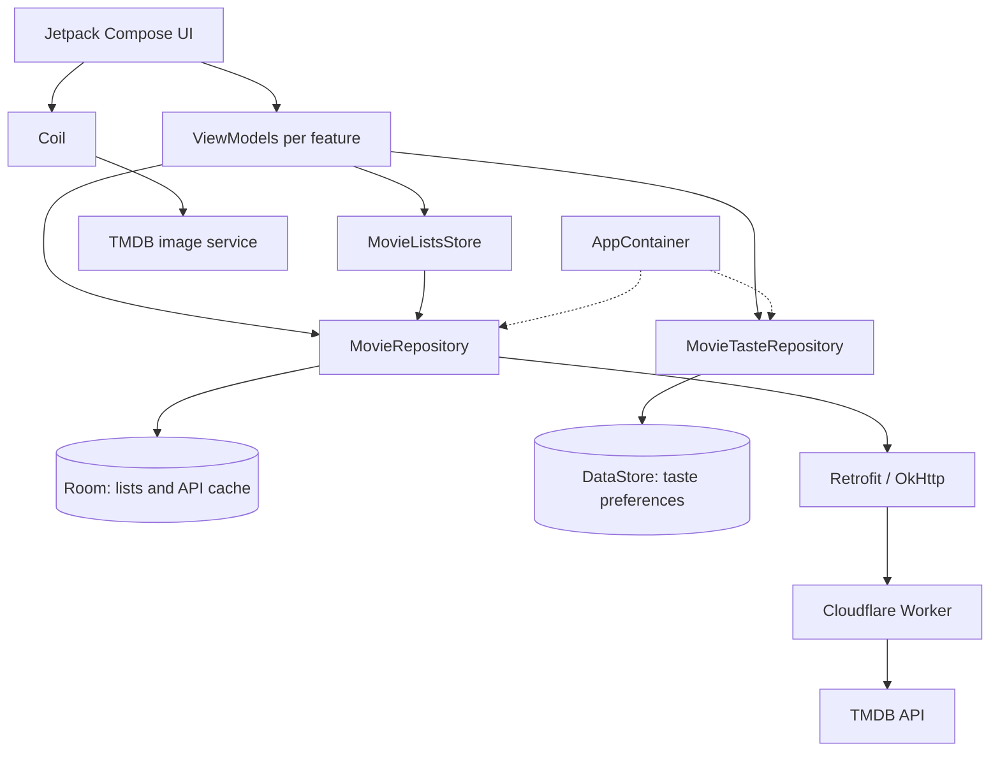

# Android architecture

The Android module is `frontend/app`; production packages live under
`frontend/app/src/main/kotlin/ee/movara/app`.

| Package | Code that belongs here |
| --- | --- |
| `ee.movara.app` (root package) | App entry points (`MainActivity`, `MovaraApplication`), dependency wiring (`AppContainer`), and app-level navigation graphs and keys (`Navigation`, `NavigationKeys`) |
| `data/remote` | Retrofit services, network DTOs and remote data sources |
| `data/local` | Room database, DAOs, entities and the Preferences DataStore delegate |
| `data/network` | Connectivity observation through `NetworkMonitor` and `AndroidNetworkMonitor` |
| `data/repository` | Repository interfaces and implementations; source coordination and mapping to domain models |
| `domain/model` | Shared plain Kotlin app models, independent of network, database and UI types |
| `domain/recommendation` | Pure recommendation ranking and Like-seed selection |
| `ui/<screen>` | Screen composables, UI state/events and ViewModels where needed |
| `ui/theme` | Shared Compose colours, typography and theme |

Screen packages include `ui/home`, `ui/search`, `ui/genres`,
`ui/selectedgenre`, `ui/moviedetails`, `ui/movies`, `ui/preferences` and
`ui/about`. Keep screen UI state with its feature; shared list state lives in
`ui/movies/MovieListsStore.kt` and reusable movie/genre models in `domain/model`.

Data flow: **Screen → ViewModel → repository → remote/local source**.
State flows back to the screen through a read-only `StateFlow`, collected with
`collectAsStateWithLifecycle`. ViewModels accept repository interfaces through
their constructors and never call Retrofit services or DAOs directly. Repositories
own data access, mapping and cache/persistence decisions. Screens render state and
forward user actions to their ViewModel.

Use simple manual dependency injection for now: `MovaraApplication` owns one
`AppContainer`, which creates shared repository instances lazily. `MainActivity`
passes the container to navigation, where lifecycle-managed ViewModels are created
with `viewModel { ScreenViewModel(container.repository) }`. Do not construct
repositories inside screen composables or ViewModels. Add future services, databases
and repositories to the container; Hilt can replace it if dependency wiring grows.

The running app uses `HomeViewModel`, `SearchViewModel`,
`SelectedGenreViewModel`, `MovieDetailsViewModel`, the preference ViewModels and
the shared `MovieListsViewModel`. The old `ui/main/MainScreenViewModel` and
`DataRepository` greeting example remain in source but are not wired into the
current navigation graph. Mirror production packages under `src/test/kotlin`
and `src/androidTest/kotlin`; use fake repository interfaces for ViewModel tests
and pass plain state/data to screen UI tests and previews.

## Development environment and technology stack

Open the repository root's [settings.gradle.kts](../settings.gradle.kts) in
**Android Studio Panda 3 (2025.3.3 Patch 1) or newer**, as required by the
[frontend setup guide](../frontend/README.md). There is one Gradle project:
`:app` maps to `frontend/app`; `frontend/` is not a separate project.
Use the IDE's bundled JDK as the Gradle JDK. The app explicitly uses a **JDK 17
toolchain** and Java 17 source/target compatibility; the root settings enable
Foojay toolchain resolution. The Gradle Wrapper is **9.3.1**, with **AGP 9.1.1**
and its built-in Kotlin support.

The app compiles against **SDK 37.0**, targets **SDK 37**, and supports
**API 26 (Android 8.0) and newer**. Follow the frontend guide for SDK Platform 37.0,
Build-Tools 36.0.0, emulator setup and troubleshooting. After Gradle sync, select
the shared **Movara** run configuration, the `debug` variant and a running device,
then click Run. Startup reads the local taste profile and opens the quiz or Home.
No Movara account or developer TMDB key is needed. Commands below run from the
repository root; on Windows use `.\gradlew.bat` in place of `./gradlew`.

Versions are centralized in [libs.versions.toml](../gradle/libs.versions.toml);
SDK levels, dependencies and build types are in the
[app build file](../frontend/app/build.gradle.kts).

| Technology | Current configuration and purpose |
| --- | --- |
| Kotlin | 2.3.20 Compose compiler and serialization plugins; Kotlin models, null safety and suspend functions keep UI/data boundaries explicit. |
| Jetpack Compose and Material 3 | Compose BOM 2026.03.01 aligns UI libraries; declarative screens render state, while Material 3 supplies themed components and accessibility foundations. |
| Navigation Compose | 2.10.2; typed routes, back-stack ViewModel ownership and saved/restored bottom-tab state in `Navigation.kt`. |
| Lifecycle ViewModel, StateFlow and coroutines | Lifecycle 2.10.0; ViewModels own cancellable coroutine work and expose observable StateFlow state, collected with lifecycle awareness. |
| Retrofit, OkHttp and kotlinx.serialization | Retrofit 3.0.0 defines suspend endpoints, OkHttp 5.5.1 supplies transport/timeouts and optional logging, and JSON 1.12.0 parses DTOs. Mapping/validation keeps transport types out of screens. |
| Room and KSP | Room 2.8.5 with KSP 2.3.13 generates typed DAOs, reactive list queries and persistent metadata caching with explicit migrations. |
| Preferences DataStore | 1.3.0; atomic, observable storage for the small taste/onboarding profile, separate from relational movie lists. |
| Coil | 3.6.3 with Compose and OkHttp network support; asynchronous images, placeholders and an application-wide 100 MiB disk cache. Its ImageLoader is configured in `MovaraApplication` separately from the container's Retrofit client. |
| Cloudflare Worker | TypeScript proxy in `backend/`, deployed with Wrangler; validates allowed GET paths/parameters and keeps the TMDB key in a Worker secret. It has no user database. Node.js 22 setup is in the [backend guide](../backend/README.md). |

## MVVM layers and dependency wiring



Solid arrows show calls/dependencies; dotted arrows show dependency injection.
`MovaraApplication` owns `AppContainer`, which creates the shared repositories,
Retrofit service/client and Room database. `Navigation.kt` supplies dependencies
when creating lifecycle-managed ViewModels. The repository interfaces are backed
by `DefaultMovieRepository` and `DataStoreMovieTasteRepository`.

The ViewModel box represents separate feature ViewModels, each using only the
dependencies it needs. `MovieListsViewModel` owns `MovieListsStore` and its
coroutine scope; Home and Movie Details receive the same store, while My Movies
uses the owning ViewModel. Room observations update shared list state; ViewModels
expose StateFlow UI state collected with `collectAsStateWithLifecycle`. Return
flows and Home's recommendation orchestration/ranking are omitted for readability.
Genres uses a fixed catalogue and bundled artwork without a ViewModel.

Room stores movie lists and cached API responses; DataStore stores the separate
taste/onboarding profile. Metadata requests pass through the Worker to TMDB.
Coil uses its own application-wide ImageLoader to load movie images directly from
TMDB's image service, independently of Retrofit and Room.

## TMDB API

Movie metadata comes from TMDB through the Cloudflare Worker proxy in `backend/`.
`AppContainer` owns one Retrofit HTTP client and one `TmdbApiService`; service
functions are `suspend` functions that return parsed responses and throw on a failed
request. `BuildConfig.TMDB_BASE_URL` selects the Worker environment. The Android app
contains no TMDB key or key-injecting interceptor: the Worker adds `api_key` from its
`TMDB_API_KEY` secret when forwarding allowed requests to
`https://api.themoviedb.org/3`. HTTP logging follows
`BuildConfig.ENABLE_HTTP_LOGGING`.

Posters and backdrops follow a separate path: `TmdbImage` loads
`https://image.tmdb.org/t/p/{size}{path}` through Coil, without the Worker or an API
key. Cards use w342, Spotlight w500 and Movie Details backdrops w780. The shared
ImageLoader enables crossfade and a 100 MiB disk cache; loading/error placeholders
keep cards usable when an image is missing. Image caching is independent of Room's
metadata cache, so offline metadata does not guarantee an available poster.

Movie-data consumers receive the `MovieRepository` interface through constructor injection.
`AppContainer.movieRepository` owns one lazy `DefaultMovieRepository`, using the shared
`TmdbApiService`, `TmdbCacheDao` and `SavedMovieDao`.
Repositories map responses to domain models, with `MoviePage` retaining pagination metadata.
ViewModels and screens do not see Retrofit types, Room entities or network exceptions.

`RepositoryResult` represents success or a safe categorized error. Success identifies
network, cache or local-list data; TMDB results include the last successful fetch time.
By default the repository makes one network attempt and persists validated DTO responses
before returning fresh data. Home opts into validated cache reuse for up to six hours
through `MovieRequestPolicy.PREFER_FRESH_CACHE`; these hits make no network attempt. A cache write failure keeps the fresh result usable and reports
`cachePersisted = false`. Recoverable failures load the matching Room cache entry;
cached results may be stale. Cancellation propagates normally.

Saved-list observations, counts and membership are flows of results containing domain
data. Saving a watched membership also removes Watch Later inside one DAO transaction;
liked membership remains independent. `observeLists()` reads all memberships in one
query, providing a consistent snapshot to `MovieListsStore`, whose coroutine scope is
owned by the navigation-scoped `MovieListsViewModel`. Home and Movie Details depend on
the store rather than another ViewModel.
Home, My Movies and Movie Details share that state and write through the repository.
Home retains its Spotlight card and uses the personalized recommendation orchestration
and ranking described below. Watched changes rerank all fetched candidates without
another TMDB request. Recommendations stay hidden until the
saved-list snapshot loads successfully, including during retries and storage errors.
Search supports debounced queries, explicit submission, pagination and movie navigation.
AndroidNetworkMonitor observes the default network and checks whether
it has validated internet connectivity. The application displays an
accessible offline banner when connectivity is unavailable.

The offline banner does not prevent navigation or hide locally saved
movies. Network-dependent screens retain their existing error handling
and provide request-specific retry actions. The repository uses validated
cached TMDB responses when a recoverable network request fails.

Home tracks failed recommendation sources independently, preserving
successful recommendation batches and retrying only failed sources when
the user's preferences, Likes, and request date have not changed.

Write failures preserve the last Room snapshot and leave recommendations and list
actions available. The store emits one feedback event per failed write or confirmed
change. Navigation owns the shared SnackbarHost: successful changes show confirmation,
removals offer Undo, and failed writes offer Retry for the same operation. Only loading,
observation errors and a pending write for the same movie block membership actions.
My Movies uses counted segmented tabs, one list on compact screens and two columns
from 600 dp, with independent saved scroll positions per category.


The endpoints, the failure behaviour and the logging rules are in
[docs/api-docs.md](api-docs.md).

## Feature data flow: Like a movie

Movie Details provides a complete example. The implementation is in
[MovieDetailsRouteContent.kt](../frontend/app/src/main/kotlin/ee/movara/app/ui/moviedetails/MovieDetailsRouteContent.kt),
[MovieDetailsViewModel.kt](../frontend/app/src/main/kotlin/ee/movara/app/ui/moviedetails/MovieDetailsViewModel.kt),
[MovieListsStore.kt](../frontend/app/src/main/kotlin/ee/movara/app/ui/movies/MovieListsStore.kt),
[DefaultMovieRepository.kt](../frontend/app/src/main/kotlin/ee/movara/app/data/repository/DefaultMovieRepository.kt)
and [SavedMovieDao.kt](../frontend/app/src/main/kotlin/ee/movara/app/data/local/SavedMovieDao.kt).

1. The user presses Like in `MovieDetailsScreen`. `MovieDetailsRouteContent`
   wires `onLikeClick` to `MovieDetailsViewModel.toggleLike()`.
2. `toggle(LIKED)` builds a domain `Movie` from the loaded details and calls
   `MovieListsStore.setMembership(movie, LIKED, selected)`, using the inverse of
   the current membership. Home's `HomeViewModel.toggleLike(movie)` uses the same
   store, so both entry points share write and observation behaviour.
3. The store rejects actions while lists are loading, observation has failed, or
   that movie already has a pending write. It adds the ID to `pendingIds` and
   launches work in the scope owned by `MovieListsViewModel`.
4. Adding a Like calls `MovieRepository.saveMovie(movie, LIKED)`.
   `DefaultMovieRepository` validates the ID/title and runs the write on
   `Dispatchers.IO`. It builds a `SavedMovieEntity` with ID, title, poster path,
   year, list type and addition timestamp, then calls `SavedMovieDao.upsert()`.
   The composite key prevents duplicate Likes. Liking does not change Watch Later
   or Watched membership and does not call Retrofit.
5. Room re-emits rows through `SavedMovieDao.observeAllMovies()`. The repository's
   `observeLists()` maps the new rows into `RepositoryResult.Success(MovieLists,
   LOCAL)`; the store replaces its snapshot. It waits for that observation to
   confirm the requested membership before emitting success feedback.
6. `MovieDetailsViewModel.uiState` combines details with the store's StateFlow,
   recalculating `isLiked` and action availability. Lifecycle-aware collection
   recomposes the button. My Movies observes the same snapshot and updates its
   list/count; Home observes changed Likes and refreshes recommendation sources.
   Navigation consumes the store feedback and shows an “Added to Liked” snackbar.

The store clears the pending ID in `finally`. It does not optimistically mark the
movie liked: if a database write fails, the repository returns a safe
`RepositoryResult.Error` with category `DATABASE`, the last observed snapshot
remains visible, and the snackbar offers Retry for the same operation. Invalid input
also returns an error; coroutine cancellation is rethrown. Observation failures
keep the last snapshot but disable membership actions and expose a storage retry.
If observation fails while awaiting write confirmation, the store suppresses success
feedback; a later retry reads the actual stored membership.

Pressing Like again calls `removeMovie(id, LIKED)`; confirmed removal offers Undo,
which saves it again. Writes need no internet connection. A successful Room write
persists in `movara.db`; after a restart the newly created store subscribes to Room
and restores the saved membership. In-memory pending IDs/snackbars are transient,
and failed writes are not queued for automatic retry. This persistence is separate
from loading the movie's details, which may still require network or cached metadata.

## Local database

Movara stores the user's movie lists in the Room database `movara.db`.
The current database version is 2. The explicit `MIGRATION_1_2`, registered in
AppContainer, adds `tmdb_cache` without changing existing saved movies or their index.
There is no destructive fallback.

The `saved_movie` table uses `(tmdbId, listType)` as its composite primary
key, allowing a movie to belong to multiple lists independently.
DAO queries expose Flow values, ordered by newest addition first,
and provide a movie count for each list.

The separate `tmdb_cache` table stores a request key, serialized TMDB DTO and successful
fetch timestamp. Keys distinguish endpoints, normalized queries, movie/genre IDs and
individual pages, including movie details. Failed requests do not replace successful
entries; fallback reads and validates the persisted response. Entries are retained for
offline fallback even after Home's six-hour freshness window expires. There is no eviction
or automatic retry. This response cache never changes a user's saved-list memberships.

Database schemas are exported to `frontend/app/schemas` and committed
to version control.

Future schema changes must increment the database version and provide
a tested migration that preserves existing user lists. Destructive
migration fallback is not used because the lists contain user data.

AppContainer owns the database instance. Repositories access DAOs;
screens and ViewModels do not access the database directly.

## Movie taste preferences

The first-launch quiz and Home recommendations share the `MovieTasteRepository`
interface. `AppContainer` owns its `DataStoreMovieTasteRepository` implementation,
backed by one application-scoped Preferences DataStore in
`files/datastore/movie_taste.preferences_pb`.

The profile stores up to five preferred genre IDs, favourite movie IDs, an optional
minimum TMDB rating (6, 7 or 8), and an onboarding status: `NOT_STARTED`, `COMPLETED`
or `SKIPPED`. Favourite titles are saved as optional display metadata in the same
atomic update, so reopening the quiz does not require network access to recognize
saved selections. Quiz favourites are separate from the Room Like, Watch Later and
Watched lists; selecting one does not change any list membership.

Older profiles containing only IDs remain readable. Missing titles can be resolved
through movie details, but every selected ID always has a removable chip, using a
numbered fallback label when its title is unavailable. Unreadable optional title
metadata is ignored without discarding IDs or resetting onboarding status.

Draft answers belong to the quiz UI state. Saving atomically replaces all preferences
and marks onboarding completed; later edits use the same operation. Skipping marks
a new profile as skipped without overwriting a completed profile. Both operations
survive app restarts. The profile Flow exposes persisted data only. Read and write
failures propagate to the caller instead of silently resetting the user's preferences.
Database and DataStore files are excluded from backup and device transfer.

Before constructing the normal navigation graph, `PreferenceStartupViewModel` reads
the stored profile. New installations see the three-step genre, favourite-film and
minimum-rating quiz. Completed/skipped profiles go directly to Home. A storage-read
failure offers retry or entry to Home for the current session without changing the
stored status.

`MoviePreferenceQuizViewModel` keeps draft answers, the current step and search query
in `SavedStateHandle`; leaving an edit without saving does not change the profile.
The movie picker uses shared `MovieDiscovery.familiar` options: most-voted first,
minimum rating 6, at least 100 votes, and already released by the current UTC date.
It interleaves selected genres' paginated results, or discovers across all genres
when none are selected. There are no decade quotas or weighted scores. It also
supports debounced title search without the browsing quality floor; search accepts
unknown release dates but excludes explicitly future-dated films. Selections persist
across searches and pages. **Show more** remains available when filtering removes
all displayed results but further pages exist. Home's **Your taste** action opens the same quiz
with existing preferences. Saving errors retain the draft for retry; first-launch
users can also continue for the current session without saving.

## Personalized Home recommendations

Home observes the persisted taste profile and the complete Like/Watched lists.
`HomeRecommendationLoader` requests the first recommendation page for up to ten
Likes and five quiz favourites (favourites in stable ID order); overlapping seed IDs are requested
only once. `RecommendationSeeds.selectLikes` always includes the five most recent Likes.
For at most ten Likes, every Like is used. Larger histories also contribute five older
Likes from ID-sorted, consecutive windows that rotate with the UTC date. The selection
is stable for an unchanged history and date, covers the older history over successive
days, and is recalculated on the next Home load; there is no midnight background job. It also requests popular movies for each preferred genre,
using `MovieDiscovery.familiar` with popularity sorting and the user's minimum rating,
plus one weekly-trending page for discovery. At most 21 source pages are needed for
a cold load: ten Likes, five quiz favourites, five genres and one trending page.
`MovieTastePreferences` enforces `MAX_GENRES = 5` on construction, including when
DataStore reconstructs a saved profile. A persisted profile with more genres produces
a read error before Home can load its sources; it is not silently truncated.
The existing preference-validation and Home request-budget tests cover these limits.
At most three requests run concurrently.
All selected favourites and all Likes remain excluded, including those beyond the
seed request limit. Missing favourite titles do not require extra detail requests.

`MovieRecommendations.rank` is a pure function. It merges candidates by TMDB ID and
records distinct seed/genre/discovery sources, so duplicates do not inflate overlap.
It excludes Watched, all favourite/liked seed films and explicitly future-dated films.
An explicit minimum rating applies to every source, including cached and discovery
results; unknown or lower ratings cannot satisfy it. The minimum is never lowered.

Eligible films are ordered by these rules, in order:

1. Number of distinct favourite/liked movie recommendation sources.
2. Number of preferred genres matched by metadata or a genre-discovery source.
3. At least 100 community votes before less-established ratings.
4. TMDB rating, then vote count, descending; finally TMDB ID ascending for stable ties.

There are no weighted scores or decade quotas. The highest-ranked eligible result
is Top Pick. At most 24 films are retained, with at most four discovery-only films
when personalized candidates exist. After Top Pick, presentation prefers the next
ranked candidate with a different source and genre from the preceding film, when
available, otherwise retaining ranking order. With no preferences or Likes, discovery
can fill all 24 places. Reasons identify an enjoyed film, a preferred genre, or trending.

The spotlight and remaining movie row share this deduplicated selection; Top Pick
is not repeated in the row. Profile or Like changes cancel stale loads and refresh
sources. Watched changes immediately refilter/rerank fetched candidates without
network requests; removing a Watched entry can restore a candidate. Watch Later
changes update action membership without changing recommendations.

Home reuses validated persistent MovieRepository responses younger than six hours,
without extending their fetch timestamp. New Likes fetch only source pages that are
missing or no longer fresh; unchanged sources reuse their cached pages. Genre/rating/date
filters remain part of each cache key. Corrupt, unreadable or future-dated cache entries
do not prevent a network attempt. A `freshCacheHit` is normal reuse and does not show
the stale/offline notice. Error-fallback cached results remain labelled.
Individual source failures keep successful results visible with retry feedback.
A missing profile or unreadable Like/Watched list cannot silently bypass saved filters.
Retry resubscribes to profile and Watched observations and makes network-first
source requests, bypassing fresh-cache reuse while retaining offline fallback.
Subsequent automatic Like/profile changes prefer fresh cache again. Empty
results explain an active minimum rating and leave **Your taste** accessible.
Discovery cache keys still include the exact cutoff date: an offline session on a
new date may lack genre-cache entries, while previously cached seed/trending results
can remain available. Home uses the same proxy endpoints and discovery rules as the quiz.

## Staging and production

There are three build types and no product flavors. All use namespace
`ee.movara.app`, version code 1 and base version name `1.0`.

| Variant | Application ID | Worker environment | HTTP BODY logging | Debuggable | R8 minification / resource shrinking | Signing |
| --- | --- | --- | --- | --- | --- | --- |
| `debug` | `ee.movara.app` | staging | on | yes | off / off | local debug keystore |
| `staging` | `ee.movara.app.staging` | staging | on | yes | on / on | local debug keystore, inherited from debug |
| `release` | `ee.movara.app` | production | off | no | on / on | release keystore only when configured; otherwise unsigned |

Staging uses `initWith(debug)`, adds `.staging` to the application ID and
`-staging` to the version name, and deliberately enables both shrinking options.
This lets the team exercise R8 before release while retaining logging/debuggability.
Staging installs alongside the main app with its own local data. Debug and release
share an ID; installing one over the other also depends on compatible signatures.
Staging does not inherit `debugImplementation` Compose tooling dependencies.

Both shrunk variants use `proguard-android-optimize.txt` and
`frontend/app/proguard-rules.pro`. Their obfuscated stack traces require the
matching `frontend/app/build/outputs/mapping/<variant>/mapping.txt`.
Use debug for Compose tooling and unminified debugging.

`BuildConfig.TMDB_BASE_URL` selects
`https://movara-tmdb-proxy-staging.movara.workers.dev/` for debug/staging and
`https://movara-tmdb-proxy-production.movara.workers.dev/` for release.
`BuildConfig.ENABLE_HTTP_LOGGING` controls the logging interceptor independently
of debuggability. These are configured addresses, not proof of live deployment.

From the repository root, build APKs with:

```sh
./gradlew :app:assembleDebug
./gradlew :app:assembleStaging
./gradlew :app:assembleRelease
```

APKs appear under `frontend/app/build/outputs/apk/<variant>/`.
`./gradlew :app:bundleRelease` creates a release app bundle under
`frontend/app/build/outputs/bundle/release/`. Select a variant in Android Studio
using **Build > Select Build Variant**. See the
[frontend build/signing guide](../frontend/README.md#6-build-variants) for details.

Release signing reads `RELEASE_KEYSTORE_PATH`, `RELEASE_KEYSTORE_PASSWORD`,
`RELEASE_KEY_ALIAS` and `RELEASE_KEY_PASSWORD` from ignored root
`local.properties`, falling back per value to environment variables. Keep the
keystore outside the repo; `*.jks` and `*.keystore` are ignored. Use forward
slashes in property-file paths; relative paths resolve against the repository root.
When all four values are absent, release builds with a warning and produces an
unsigned package (the unsigned APK cannot be installed). Partial configuration or
a nonexistent keystore fails `assembleRelease` / `bundleRelease` through
`checkReleaseSigning`; wrong passwords/aliases fail signing. No release signing
credential is required for debug or staging.

The Worker environments are declared in
[wrangler.jsonc](../backend/wrangler.jsonc). From `backend/`,
`npm run deploy:staging` and `npm run deploy:production` deploy the matching
Workers. Each requires its own `TMDB_API_KEY` Cloudflare secret; no key is bundled
in any APK or BuildConfig field. Local Worker development uses ignored
`.dev.vars`. Follow the [backend guide](../backend/README.md) for authenticated
deployment and secret entry/rotation; do not commit secrets or put them in command
arguments. The repository establishes this configuration, but cannot verify deployed
Worker versions, secret values or a distributor's release keystore.

## Permissions and user accounts

The app declares two Android platform permissions:

| Permission | Purpose |
| --- | --- |
| `INTERNET` | Request movie metadata through the Worker and images from TMDB's image service |
| `ACCESS_NETWORK_STATE` | Allow connectivity checks for offline handling |

Both are normal, install-time permissions. No runtime permission dialog is needed.
The app does not request access to the camera, microphone, location, contacts or
shared storage. Room and the image cache use app-private storage without a storage
permission. See [Android network permissions](https://developer.android.com/develop/connectivity/network-ops/connecting).
`AndroidNetworkMonitor` and the offline banner are implemented, as described above.

### Why there are no user accounts

Stage 1 scoped Movara as a personal, local movie-list app. Liked, Watch Later and
Watched entries belong to this installation and are stored in Room on the device.
There is no registration, login, password storage or account-based synchronization.
The app does not upload these lists or collect account details such as names,
email addresses or passwords.

### Why there is no separate application backend

Room and DataStore provide persistence for this installation, and recommendation
ranking runs on the device. The current scope needs neither a central user database
nor account synchronization, so Movara has no separate application backend for user
accounts or movie-list storage. It does have a small backend component: the
Cloudflare Worker in `backend/` protects the shared TMDB key and validates/forwards
metadata requests. Its code has no account, list-storage or synchronization endpoints.

### External services and privacy

Local persistence does not mean that no preference-related information leaves the
device. Searches, movie IDs and discovery filters reach Cloudflare and then TMDB.
Home requests recommendations for selected Like/quiz-favourite IDs and discovery
using preferred genres and minimum rating; those inputs can therefore reveal parts
of a user's taste. The app does not upload the Room lists or DataStore profile as a
whole. Like itself is a local write, but observing the new Like can trigger Home's
external recommendation requests.

Cloudflare receives the app's request and connection metadata. The Worker constructs
a new upstream request, adds the project TMDB API key and forwards only an explicit
`Accept` header; the app does not explicitly forward the phone's IP to TMDB.
TMDB receives the requested IDs/filters and the Worker's upstream request.
Image requests go directly to TMDB's image service, which receives the device's
connection metadata. The TMDB key authorizes public API access and is not a user's
login credential.

The current app dependencies contain no analytics, advertising or crash-reporting SDK.
Genre artwork, fonts and the TMDB logo are bundled resources. About's attribution
and licence links open external sites through `LocalUriHandler` when tapped, so
those visits are subject to the destination/browser's handling. Debug and staging
HTTP BODY logging can expose search terms, movie IDs and responses in development
logs, even though the TMDB key is absent. Repository code cannot establish
Cloudflare/TMDB retention policies or live account-level logging settings.

### Uninstalling, backups and device changes

Uninstalling the app or clearing its storage deletes the local Room database,
movie lists, DataStore taste profile and image cache. Movara has no server copy,
export or account recovery feature, so users should expect a fresh installation to
start with empty lists.

The manifest sets `allowBackup="false"` and `fullBackupContent="false"` to disable
Android cloud backup and legacy full backup. For Android 12 and newer,
`res/xml/data_extraction_rules.xml` also excludes the database directory (including
Room's journal files) and `files/datastore/` from cloud backup and device-to-device
transfer.
These transfer rules are explicit because some manufacturers do not apply
`allowBackup` to device-to-device migration. This is the app's configured policy;
device-specific transfer behavior has not been verified on every manufacturer.
See [Android backup and transfer rules](https://developer.android.com/identity/data/autobackup).

### What adding accounts would require

Accounts would require an authentication provider or backend, secure session
handling, server-side storage tied to a verified user ID, and authorization that
keeps each user's lists private. The repository would need local/remote
synchronization with conflict resolution and a migration path for existing local
lists. Privacy, retention and account/data deletion behavior would also need to be
defined before shipping that feature. These changes are outside the scope of Stage 3.

## Decisions

Choices that were not obvious, and what was rejected along the way, are recorded one
file at a time in [docs/decisions](decisions/README.md). Read the relevant decision
alongside the current implementation before changing the thing it describes.

[Decision 0001](decisions/0001-tmdb-api-key-in-the-client.md) and its index still describe
the earlier client-side key and empty-backend design. That description no longer
matches the implementation: the key now lives in the Worker secret, as documented
above and in [api-docs.md](api-docs.md). The historical decision needs a separate
update; its client-key assumptions should not be used as current setup instructions.
